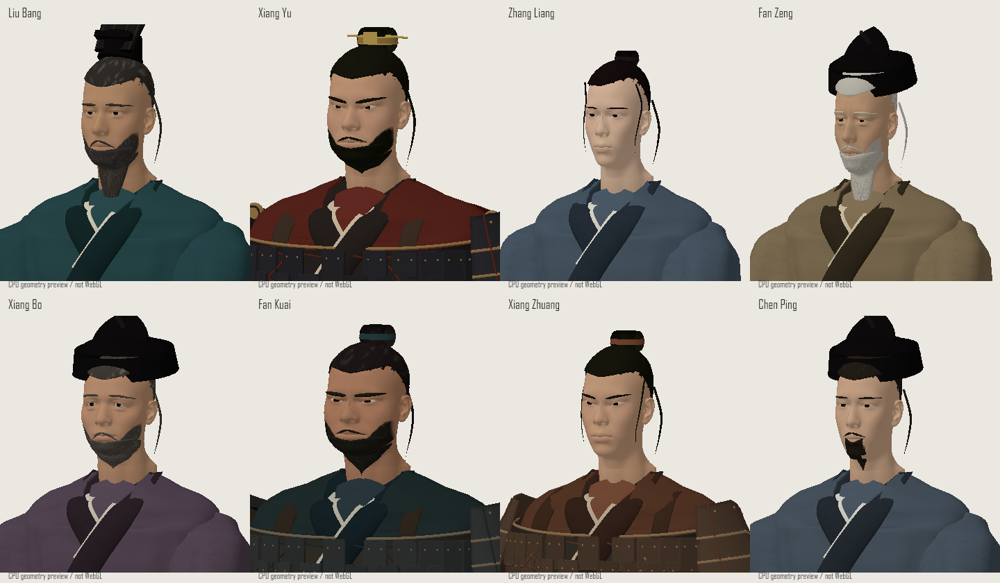
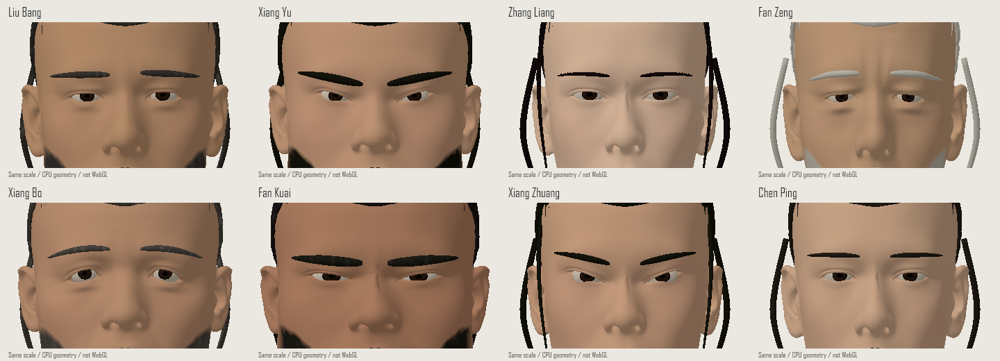
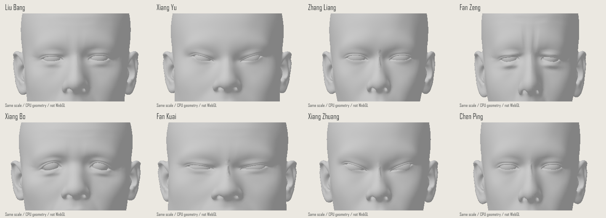
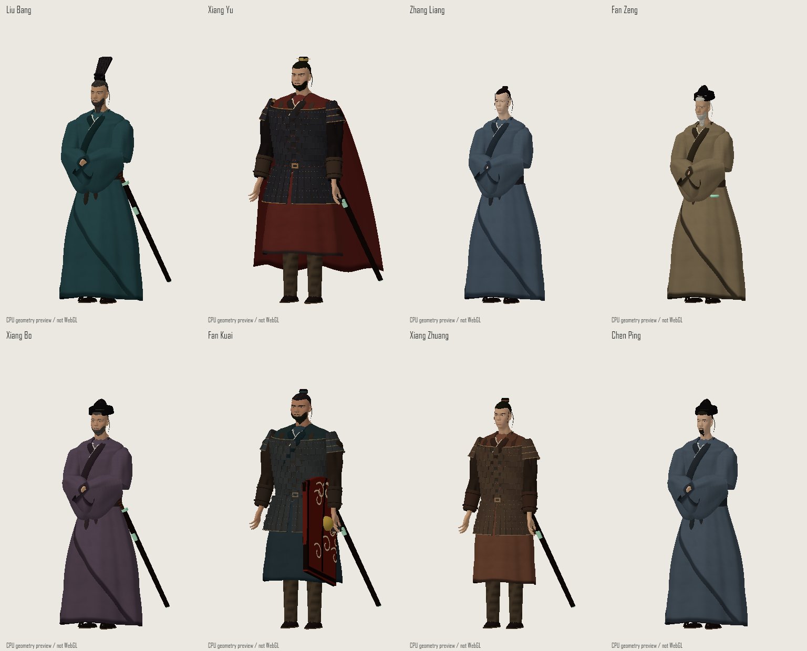
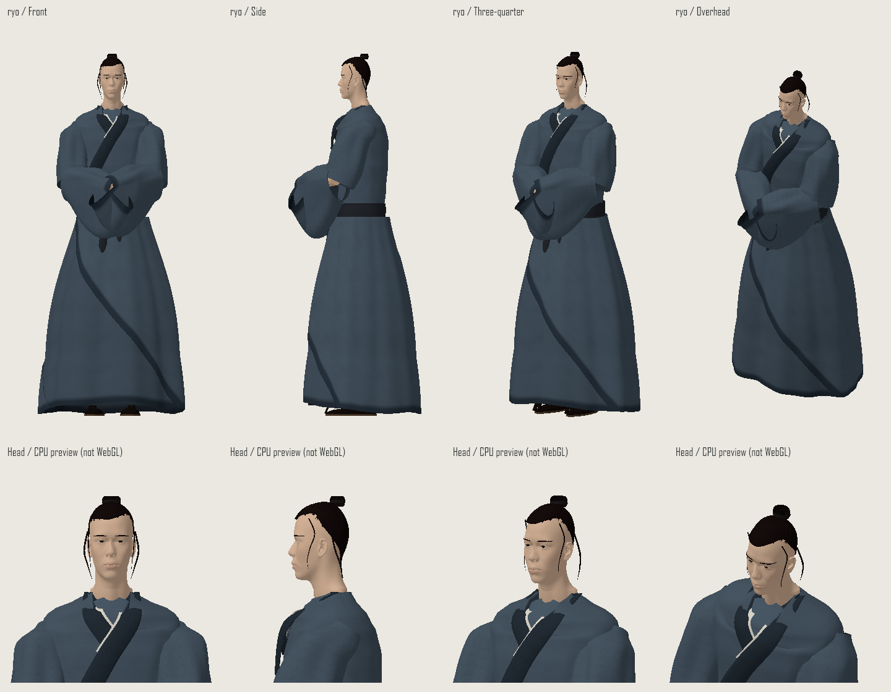
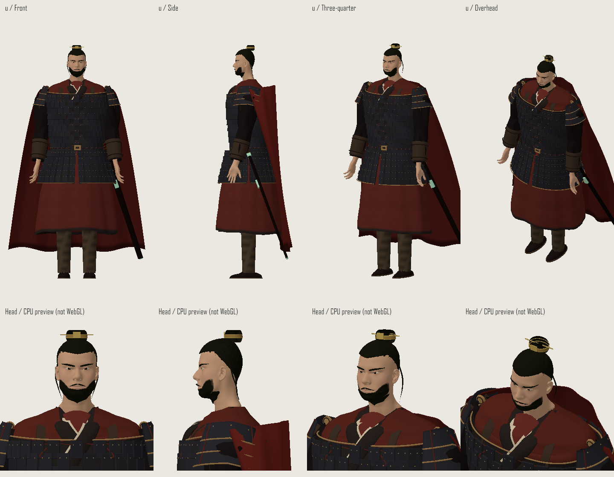
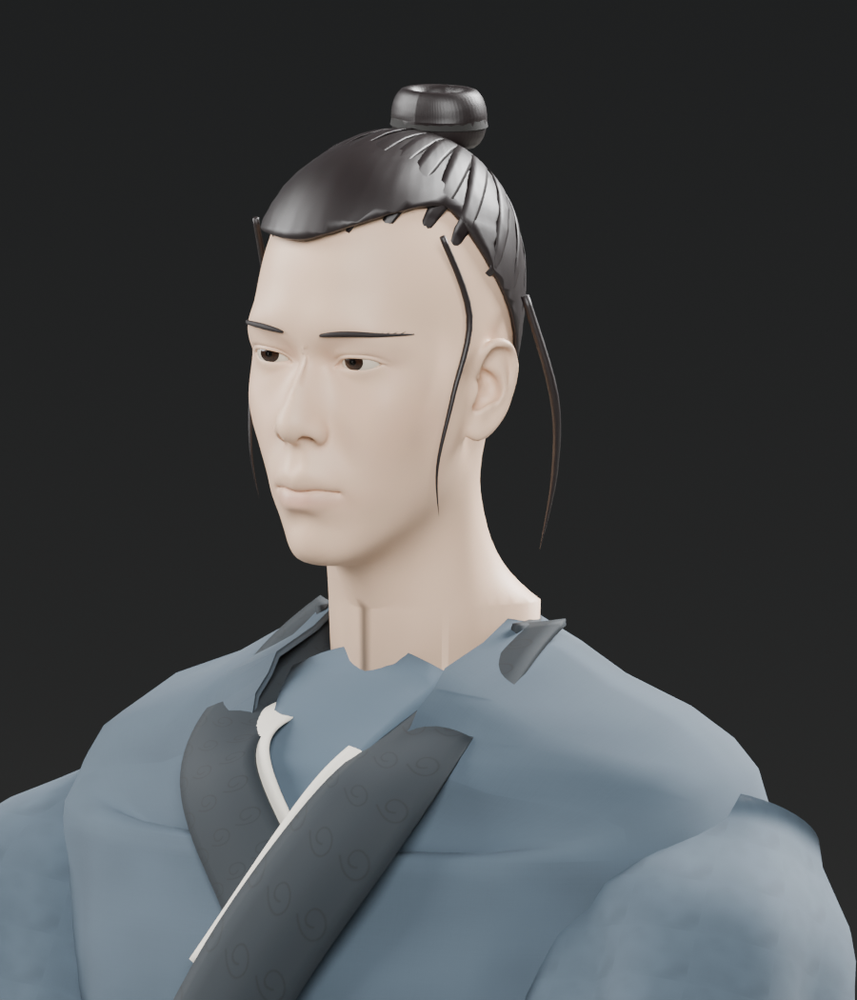

# 人物モデルの造形と確認範囲

2026-10-25。基準は `src/assets/character-atlas.png` の創作肖像です。容貌は史実の復元ではありません。胸から下の衣装は、肖像の色と服装体系から補完しています。

## 土台の交換

主要8人の頭部を旧SDFから、Blender公式Human Base Meshes（CC0）を基礎に造形した連続メッシュへ交換しました。額、眼瞼、鼻、唇、頬、顎、耳、首が一体です。眼球は各顔の眼瞼へ合わせ、新しい頭部に旧 `sculptPortrait` を重ねて適用しません。

目は横幅、上瞼の山、下瞼の弧、目頭・目尻、上瞼の重なり、目袋、眉を人物別に造形しています。色付きと同一色の拡大比較で、眉色だけによる識別になっていないことを確認します。

| 人物 | 眼形・顔の識別特徴 | 衣装と髪 |
| --- | --- | --- |
| 劉邦 | 長角顔、高い鼻、加齢した瞼とわずかな左右差 | 深い青緑、文様襟、長い黒灰髭 |
| 項羽 | 角顎、内側が重く鋭い眼裂、低い斜眉 | 黒甲、真鍮の縁、赤披風、小冠、短髭 |
| 張良 | 滑らかな頬、横長で穏やかな眼裂、整った鼻梁 | 青灰の重ね襟、流れる生え際、小さな髪留め |
| 范増 | 高い額、重い上瞼、目袋、痩せた頬 | 黄褐色、暗襟、白髪と長い白髭 |
| 項伯 | 丸めの短顔、丸みのある垂れ目、柔らかい眉 | 紫灰、短い灰混じり髭、文官冠 |
| 樊噲 | 広い顎と鼻、厚い眉間、圧縮された眼裂 | 暗い鉄甲、太い革帯、濃い頬髭 |
| 項荘 | 若い角顔、目尻へ向かう細い眼裂、鋭い斜眉 | 褐色の実用甲、赤褐色の髻紐 |
| 陳平 | 細長い顔、水平で落ち着いた眼裂、細い鼻 | 暗青灰、黒冠、細い口髭と短い顎髭 |

手も公式人体素材から作り、掌・指・手首が連続した形へ交換しています。左右と11姿勢を持ち、剣と戟は握りの中心・軸・半径へ配置します。

衣装は厚みを持つ表裏の布、重ね襟、胴の折り目、巻き身頃、重力方向へ垂れる袋袖、裏地と留め具を持つ札甲、傾斜した肩甲、床へ流れる披風です。立つ・座る・跪く裾を切り替え、軽量設定では細分・面取り・小さい鋲を減らします。物理布シミュレーションではなく姿勢に応じた変形です。

## 編集と配布

編集用の `source-assets/heads.blend`、`hands.blend`、`costumes.blend` と再生成スクリプトを保存しています。元の頭部・手は非表示のコレクションに保持しています。[出典manifest](assets/manifest.csv)と[再生成手順](../source-assets/README.md)を参照してください。

ゲームはBlenderを必要としません。座標・法線・色を量子化し、共有インデックスとともにJavaScriptへ内包します。`npm run build` で単一HTMLにも含め、実行時に外部モデルを取得しません。

## 確認方法

`tools/character-gallery.html` は実際のThree.js素材を使い、人物・姿勢・画質を切り替えて回転・拡大する確認ページです。

CPU比較は次のコマンドで再現できます。`@napi-rs/canvas` の場所が既定と異なる場合は `CANVAS_MODULE` に指定します。

```powershell
node tools/model-preview.cjs model-preview-output/review hai,u,ryo,zo,haku,kai,sou,chin high --portraits
node tools/model-preview.cjs model-preview-output/review hai,u,ryo,zo,haku,kai,sou,chin high --bodies
node tools/model-preview.cjs model-preview-output/review hai,u,ryo,zo,haku,kai,sou,chin high --eyes
node tools/model-preview.cjs model-preview-output/review hai,u,ryo,zo,haku,kai,sou,chin high --eyes --gray
node tools/model-preview.cjs model-preview-output/review sou high --pose=dance
```

CPUラスタライザは実モデルの変換と色を使い、InstancedMeshの配置、面の表裏と鏡像の向き、整数色属性の正規化を反映します。WebGLのPBR・影・バンプ・透明描画・速度を再現しません。

`tools/export-model-scene.cjs` と `tools/render-model-scene.py` は実モデルをBlenderへ渡し、別の照明で四方向を描画します。これもゲームのWebGL画面とは別の検証です。

```powershell
node tools/export-model-scene.cjs model-preview-output/scene ryo stand high
& $env:BLENDER_EXE -b --python tools/render-model-scene.py -- model-preview-output/scene/ryo-stand.json model-preview-output/render
```

確認対象は眼球と瞼、髪・髭の根元、首と襟、肩甲と紐、袖の肩・肘・手首、帯と裾、披風の床接触、武器の握りです。

## 保存した比較画像















## 残る限界

髪と髭は毛束によるゲーム向けの簡略造形で、一本ずつの毛髪や布の物理計算は行いません。原画は一方向の胸像なので、側面・背面や下半身には補完があります。主要8人以外の一部には共通ベースの控えめな変形や旧素材を使います。

ブラウザーの実画面確認は未完了です。以前のMicrosoft Edge操作が自動承認で拒否され、アプリ内ブラウザー使用可否の回答もまだないため、CPU・Blender画像と構造テストを区別して記録しています。
