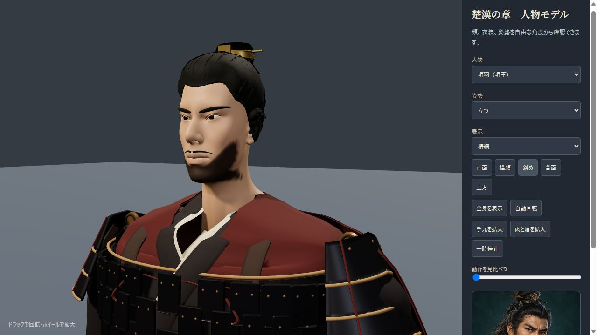
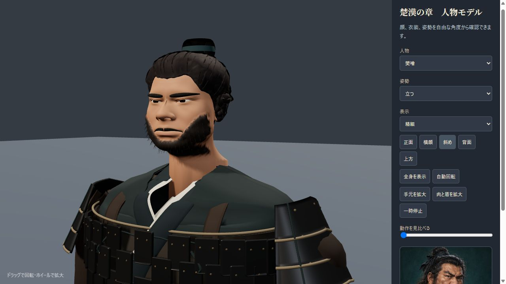
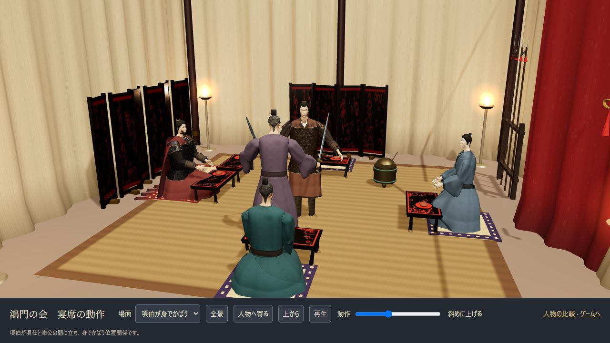
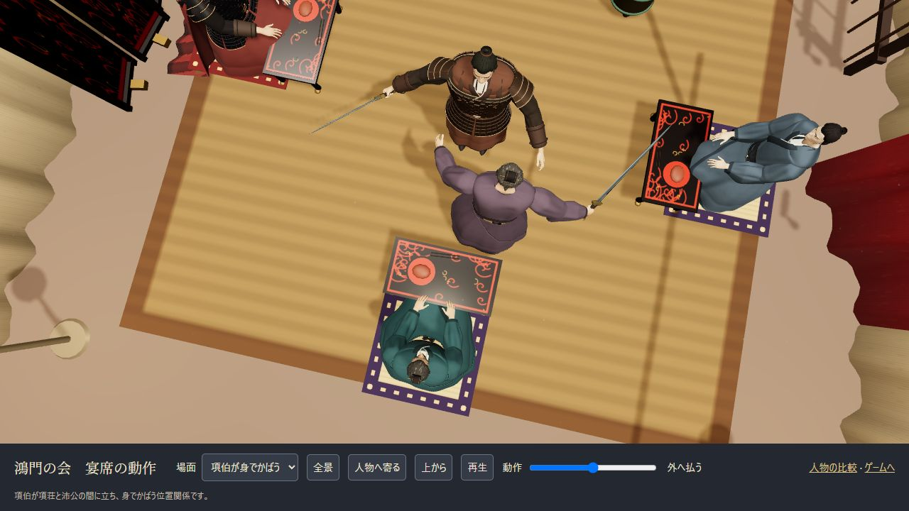

# 人物と宴席の3D品質

更新日：2026-10-26。

[人物の比較](../tools/character-gallery.html)では顔・横髪・冠・手元を回転して確認できます。[宴席の動作](../tools/banquet-scenes.html)では剣舞、項伯の翼蔽、樊噲の飲酒・食事を実際のゲーム用舞台で再生・一時停止できます。

## 人物の描き分け

主要8人の頭はBlender公式Human Base Meshes（CC0）の連続した人体メッシュを使い、鼻・口・眼瞼・頬・顎・耳・首を人物別に造形しています。目の幅だけでなく、上瞼・下瞼の曲線、目尻、瞼の重なり、目袋、眉も分けています。

| 人物 | 顔・目・髪の特徴 |
|---|---|
| 劉邦 | 加齢と左右差のある目、黒と灰の髪、長い顎髭、折り返した冠 |
| 項羽 | 縦に締まった顎と頬、鋭い眉と目、整えた短髭、後ろへ流れる側頭髪、金の冠飾り |
| 張良 | 細めの輪郭、横長で穏やかな目、鼻梁と唇の整理、厚みのある流した横髪 |
| 范増 | 重い上瞼と目袋、白髪・長髭、頭に合わせた冠 |
| 項伯 | 丸く下がる目、ふくらみのある頬、控えめな髭 |
| 樊噲 | 横に広い頬・顎・鼻、太い眉と厚い頬髭、太い首、乱れた量感のある横髪 |
| 項荘 | つり気味の目、引き締めた輪郭、赤褐色の髪結い |
| 陳平 | 水平寄りの長い目、細い口髭と顎髭、整った側頭髪 |

髪は頭頂からこめかみ・耳前・耳後・襟足へ連続する頭皮面と、根元を埋めた流れのある房で構成します。短い髭は顔の連続面へ色と量感を統合し、そこへ細い毛を植えています。長髭は顎から前へ垂れる閉じた量感です。冠は頭上の結髪に合わせ、座と留め針を備えます。

人物はプロジェクトの創作挿絵に基づくゲーム表現です。髪は簡略化した毛束で、人物の実際の容貌・衣装の厳密な歴史復元を示すものではありません。

## 衣装と握り

身頃は連続した曲面と折り、右衽の重なり、薄い内襟、厚みのある裏地で構成します。肩・胸の断面は連続接線でつなぎ、段ごとの横筋を抑えています。袖は重力方向へ垂れる形、肩の内側は布で閉じた接続です。鎧は下地・厚み・縁・綴じ紐・鋲を持ち、項羽の黒と金・赤い披風と、樊噲の実用的な鉄色を分けています。

手はCC0人体の連続メッシュ。指先方向が前腕から続き、親指側から剣身、小指側から柄頭が出ます。柄の位置と刃面の二軸を合わせ、剣のために手首を反転させません。着座では掌が膝側を向き、飲酒では片手が把手、反対の掌が器の底を支えます。

## 宴席の動作

- 剣舞は8秒周期。構え、斜め上げ、外への払い、構えへ戻す動きに胴と重心を連動させます。舞台が別の正弦移動を重ねる滑走を取り除き、項荘は沛公へ向きます。
- 項伯は項荘と沛公の間へ立ち、翼蔽の位置関係が画面から分かるようにします。
- 食事は10秒周期。低く膝を落とし、床の盾に載せた生の肩肉を切る、切った一片を刺す、口元へ運ぶ、食べる、剣を戻す段階です。赤身・脂肪層・切断面・小さい骨断面を備えた原作成メッシュを使います。
- 飲酒は6秒周期。両手で器を上げ、口縁を唇へ寄せ、傾けてから下ろします。

各動作は開始時に先頭へ戻ります。再生中の動きは時刻から決まり、確認ページでは任意の段階へ移動・再開できます。食材・器・手の接触は、上腕と前腕・道具の長さから接触円を解く方法で合わせます。前腕のねじり、肘、手首の曲げには範囲を設けています。

本文は「盾を地に伏せ、肉を載せ、剣で切って食べる」と記します。剣に一片を刺して口へ運ぶ細部は、動詞の流れを見せるための補間演出です。

## 卮の参考資料

[洪石「西汉饮酒具研究——以漆器为中心（上）」『故宮博物院院刊』2020年第12期、64–65頁](https://img.dpm.org.cn/Uploads/File/2020/12/29/u5feaced521ab7.pdf)は、円筒形・一環耳・平底の卮と、馬王堆の大卮を紹介しています。大卮には口径約16cm、蓋込み高さ約18cmの例があります。漢代漆器の出土例を参考に、細い口縁、小さな環耳、黒褐色の外面と朱の内面、雲文の器を創作復元しました。

## 編集用データ

- `source-assets/heads.blend`：人物別の顔・髪・髭と、非表示の原本。
- `source-assets/hands.blend`：原本と手指の姿勢。
- `source-assets/costumes.blend`：布、襟、帯、鎧、披風の中立姿勢。
- `source-assets/banquet-props.blend`：剣・鞘・卮・生肉・一片と、8人の冠・髪結い。

再生成は[編集手順](../source-assets/README.md)、人体原本の出典は[manifest](assets/manifest.csv)。ゲームは頂点・法線・色・UVをJavaScriptへ内包し、配布用HTMLにも含めます。

## 検証記録

`npm test`は39件（進行・保存33件と人物・リグ・宴席6件）。15人×12姿勢×2画質の360条件で有限座標・法線・インデックスを検査し、さらに192条件で剣の親指方向、柄の接触、食材・器の接触、関節の範囲を検査しています。剣舞16段階では他の登場人物の頭との距離も確認しています。

アプリ内ブラウザーで実際のWebGL表示を確認しました。主要5人は正面・横・斜め・上の20画像、剣舞と翼蔽は上方8段階、握り・生肉・口元・飲酒は近接表示を記録しています。CPUによる主要8人の比較も併用しています。

ブラウザー画像は`model-preview-output/banquet-browser/`、CPU比較は`model-preview-output/banquet-final/`。公開用の抜粋は下に掲載しています。CPU画像とBlender画像は、ブラウザー画面と区別しています。布の物理シミュレーションや実機ごとのフレームレート測定は、この検証には含みません。

