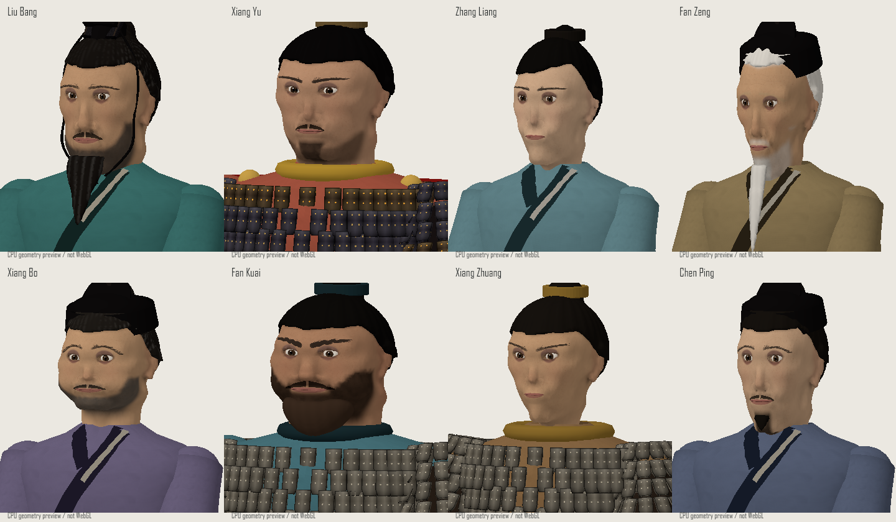
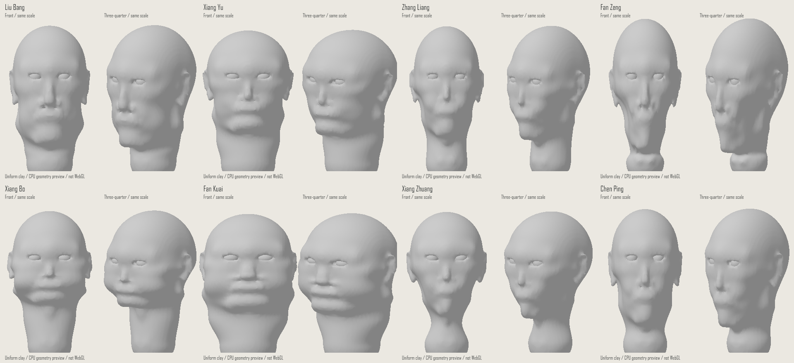
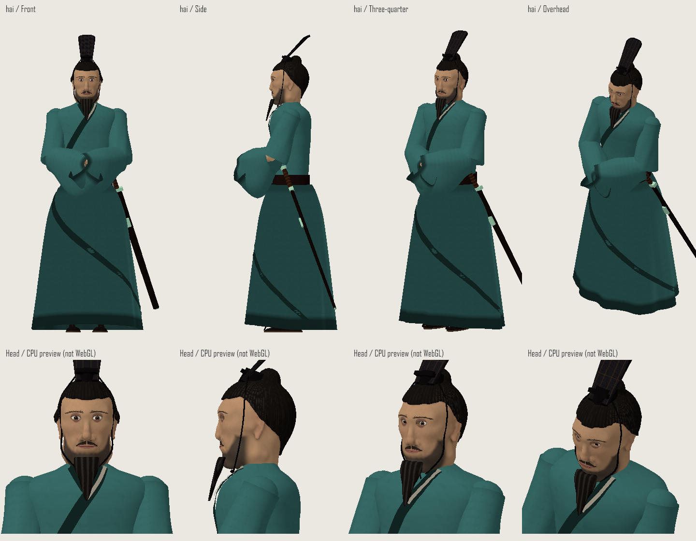
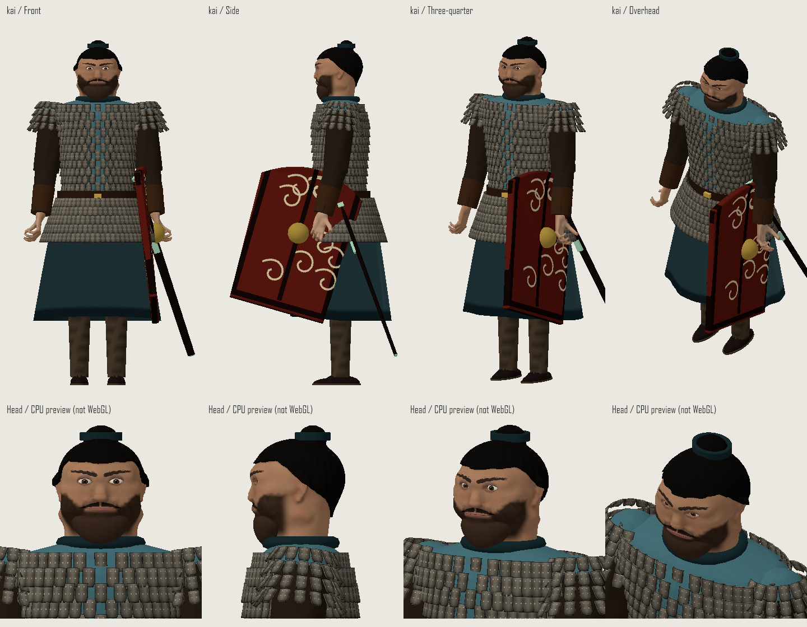

# 肖像を基準にした3D人物の調整

基準は `src/assets/character-atlas.png`。2026-10-22〜23の改修は、肖像の識別特徴を既存のThree.jsモデルへ反映するものです。肖像自体も学習用の創作であり、史実の容貌を復元したものではありません。

| 人物 | 肖像から合わせる特徴 |
| --- | --- |
| 劉邦 | 長めの輪郭、高い鼻、豊かな長髭、後退気味の生え際 |
| 項羽 | 広い顎と太い首、密な短髭、小さな冠と髻 |
| 張良 | 細い輪郭、穏やかな目元、髭のない顔 |
| 范増 | 痩せた頬、長い白髭、高い額、老齢の目元 |
| 項伯 | 丸めの輪郭、短めの白髪混じりの髭 |
| 樊噲 | 最も広い顔、厚い首、密な髭、髻留め |
| 項荘 | 若く細い顔、髭なし、簡素な髻留め |
| 陳平 | 細長い輪郭、細い口髭と短い顎髭 |

## モデルの確認方法

目元は低画質でも確認します。旧設定の開口全高3.8〜6mmはlowの頭部メッシュ間隔4.8mmに近く、皮膚が瞳を覆う原因になっていました。輪郭だけでなく、白目・虹彩・瞼の接続と、縮小表示でも目が開いて見えることを確認対象にします。

`tools/model-preview.cjs` はゲームが使う実際の人物生成コードとThree.jsを読み、Canvas上のCPUラスタライザで多方向の画像を作ります。モデルの頂点・法線・インデックスの健全性も検査します。鎧などのInstancedMeshも、各部品の変換行列と色を反映します。

これは形状・接続の確認用です。WebGLのPBR、影、バンプマップ、半透明描画、画面上の速度を再現・検証するものではありません。画像の下段にこの制約を表示しています。

```powershell
# @napi-rs/canvasのインストール先を必要に応じて指定
$env:CANVAS_MODULE = 'path/to/@napi-rs/canvas'
node tools/model-preview.cjs model-preview-output/after hai,u,ryo,zo low
node tools/model-preview.cjs model-preview-output/after hai,u,ryo,zo,haku,kai,sou,chin low --portraits
node tools/model-preview.cjs model-preview-output/after hai,u,ryo,zo,haku,kai,sou,chin low --clay-faces

# 比較対象のソースをGitの確定版から読む場合
$env:MODEL_REF = 'f54ea60'
node tools/model-preview.cjs model-preview-output/before hai,u,ryo,zo,haku,kai,sou,chin low --portraits
```

MODEL_REFを指定しない場合は作業中のソースを読みます。生成物は `model-preview-output/` に保存し、通常のビルドには含めません。ゲームの配布用HTMLは従来通り `npm run build` で更新します。

## 2026-10-22の画像レビュー

8人のlow設定の一覧と四方向、劉邦・項羽・張良・范増のhigh設定の正面・側面・斜め・上方を目視確認しました。high設定でも頭部の生成精度はゲームの設定に従いmediumです。

初稿では頬髭を結ぶ太い立体部品が肌から離れ、横顔に三角形の空隙や顎当て状の輪郭がありました。頬髭を頭部の頂点色、口髭を顔のテクスチャに置き換えた最終版では、この浮きが解消しています。長髭は顎下から連続し、確認した角度では根元の明白な空隙はありません。眼球の明白な浮きや頭部の破損も確認されませんでした。

さらに肖像の特徴をデフォルメし、顎・頬・こめかみの幅と顔の上下の長さを人物ごとに変えました。劉邦は長角顔、項羽は幅広い角顔、張良は細い卵形、范増は痩せた長顔、項伯は丸い短顔、樊噲は最も幅広い重厚な顔、項荘はV形の顎、陳平は細長い顔です。鼻、目の開き、眉の角度も調整しました。

頭部は首元の接続を保ちながら約7%拡大しています。目・髪・髭・冠も頭部と同じ変形を通し、テクスチャのUVは頂点に保持します。頬から黒い線として出ていた冠紐の端点を除去しました。髪・髭・冠・色を外した同一縮尺の灰色比較にも、ゲームと同じ `sculptPortrait` を適用しています。8人のlow設定の四方向と灰色比較で、共通の輪郭に依存していた状態からの差を確認しました。

ただし、劉邦と范増の長髭はまだ先細りの簡略形です。項羽と樊噲の後ろ顎には丸い隆起が残り、張良と陳平の細顔には共通点があります。自然な毛束、頬や目元の細かな造形、肖像の写実性を再現した完成モデルではありません。ブラウザー上のWebGL描画・照明・動作速度は、このCPU画像レビューの確認範囲に含みません。

### 保存した確認画像

2026-10-23に目元と項羽・樊噲を再調整しました。主要8人の目の開口を約10〜13mmへ広げ、眼球の大きさ・前後位置と瞼を連動させています。白目の明るさ、虹彩の比率、眼球テクスチャの影も調整し、lowの8人一覧で白目と虹彩を確認しました。目は読み取りやすさを優先した、やや丸く見開くデフォルメです。

項羽は整った斜眉・細めの鼻・露出した頬・短い顎髭、樊噲は粗い極太眉・幅広鼻・大きい口髭・高い頬髭と丸く豊かな顎髭に分けています。両者のhigh四方向で眼球と髭の接続も確認しました。

### 顎の膨らみと張良の再調整

耳の下から後ろへ壺のように膨らんでいた輪郭を、顔の母体・下顎の部品・首の筋の接続から見直しました。後ろの顎部品を細くして内側へ寄せ、首の筋の上端を下げました。項羽は下顎幅も調整し、大きな輪状の張り出しを抑えています。8人の同一色の顔比較と、項羽・張良・劉邦・樊噲のhigh四方向で、首の断絶や目・髭の浮きがないことを確認しました。

張良は大きな黒冠を小さな髪留めに換え、額を見せる流れた生え際、鼻筋、顎幅、眉と目の比率を肖像に寄せました。ただし、頬と耳下には小さな隆起が残り、目元も肖像の端正な眼瞼には達していません。現行の手続き型の頭部は球・楕円・カプセルの結合であり、張良を肖像画に近い端正な顔へ仕上げるには、眼瞼・鼻梁・頬・顎を連続した面として彫った頭部メッシュが必要です。この限界は[Blender Studioの頭部造形の説明](https://studio.blender.org/training/stylized-character-workflow/5d3a1bd54bc3ff1bb9513d3e/)も参照して確認しました。

以下は顎と張良を再調整した後のCPU画像です。実ブラウザーのWebGL画面はこの画像で検証できません。









