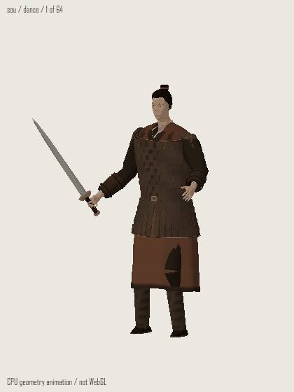
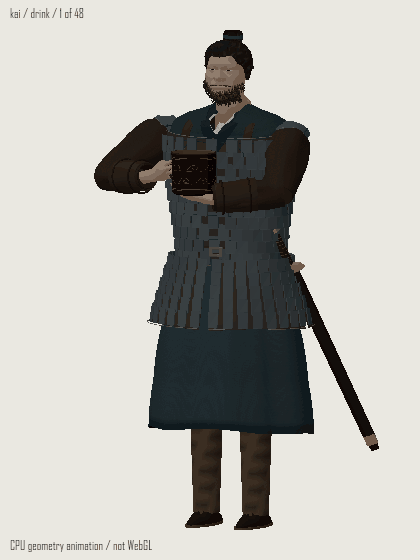
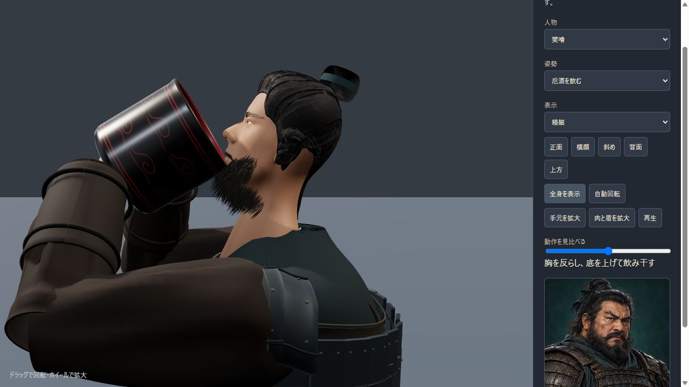
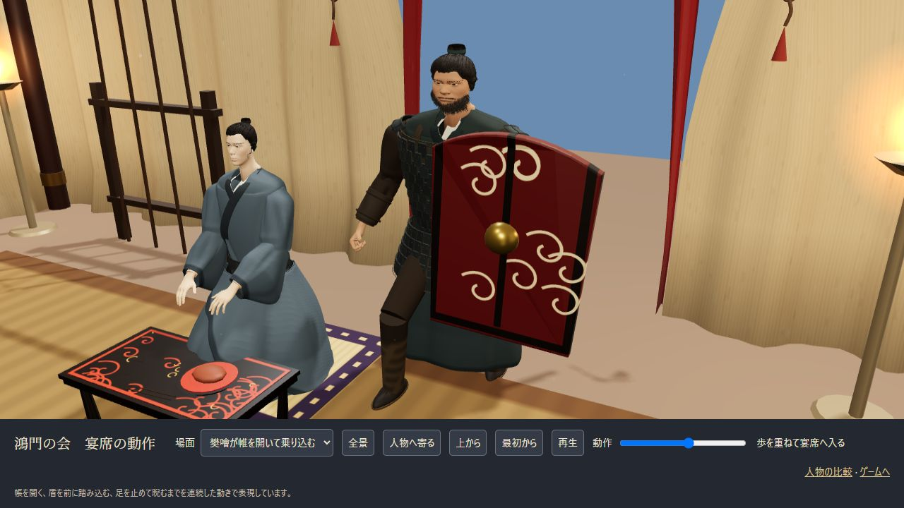
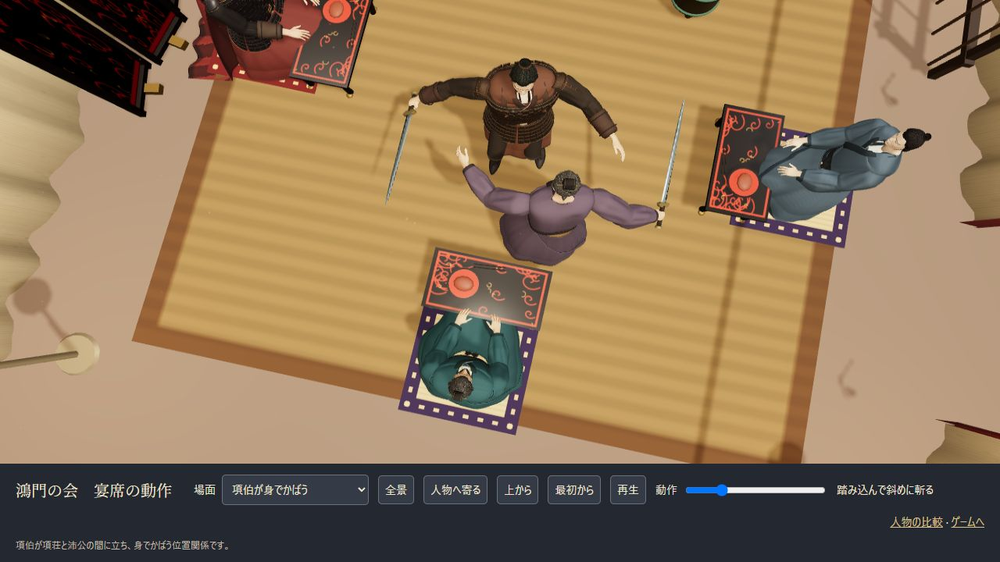
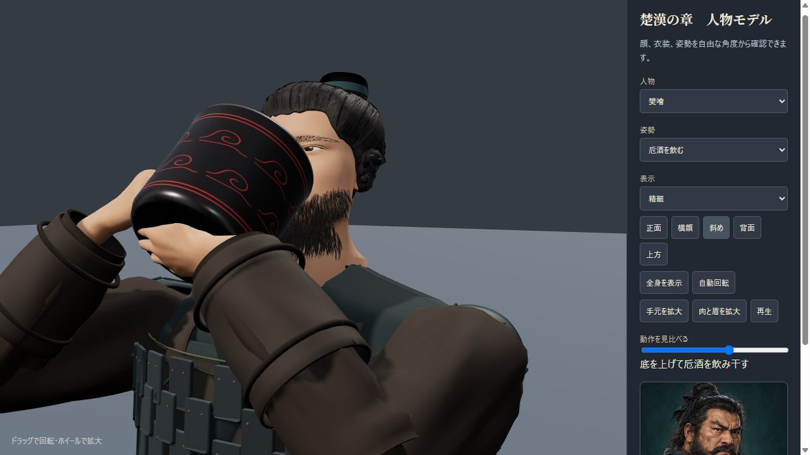
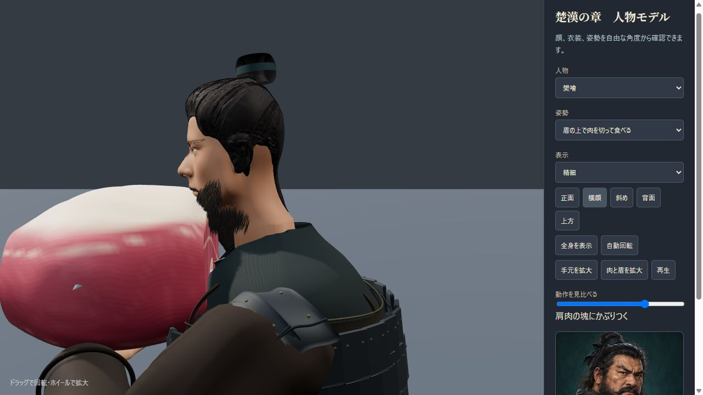
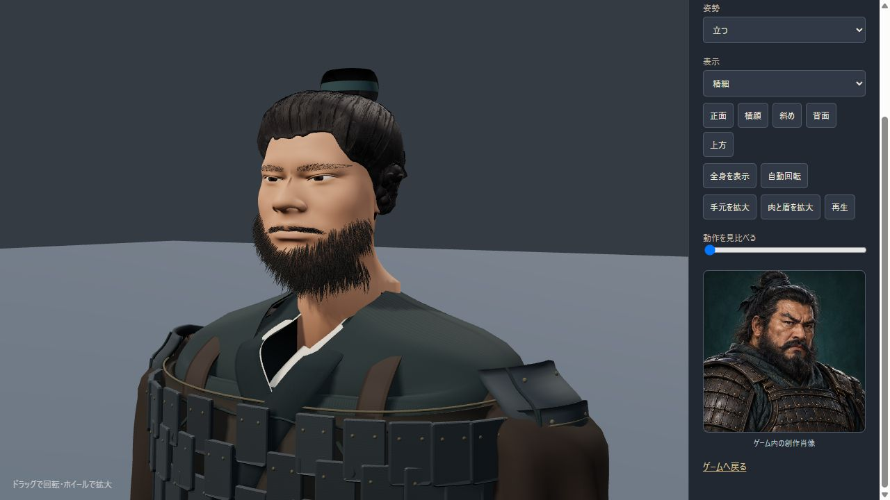

# 人物と宴席の3D品質

更新日：2026-10-27。

[人物の比較](../tools/character-gallery.html)では顔・横髪・冠・手元を回転して確認できます。[宴席の動作](../tools/banquet-scenes.html)では剣舞、項伯の翼蔽、樊噲の飲酒・食事を実際のゲーム用舞台で再生・一時停止できます。

## 人物の描き分け

主要8人の頭はBlender公式Human Base Meshes（CC0）の連続した人体メッシュを使い、鼻・口・眼瞼・頬・顎・耳・首を人物別に造形しています。目の幅だけでなく、上瞼・下瞼の曲線、目尻、瞼の重なり、目袋、眉も分けています。

| 人物 | 顔・目・髪の特徴 |
|---|---|
| 劉邦 | 加齢と左右差のある目、黒と灰の髪、長い顎髭、折り返した冠 |
| 項羽 | 縦に締まった顎と頬、鋭い眉と目、整えた短髭、後ろへ流れる側頭髪、金の冠飾り |
| 張良 | 細めの輪郭、横長で穏やかな目、鼻梁と唇の整理、厚みのある流した横髪 |
| 范増 | 重い上瞼と目袋、白髪・長髭、頭に合わせた冠 |
| 項伯 | 丸く下がる目、ふくらみのある頬、控えめな髭 |
| 樊噲 | 横に広い頬・顎・鼻、太い眉と厚い頬髭、太い首、乱れた量感のある横髪 |
| 項荘 | つり気味の目、引き締めた輪郭、赤褐色の髪結い |
| 陳平 | 水平寄りの長い目、細い口髭と顎髭、整った側頭髪 |

髪は頭頂からこめかみ・耳前・耳後・襟足へ連続する頭皮面と、根元を埋めた流れのある房で構成します。肌を黒く塗る髭を廃し、顔面へ根を埋めた立体的な毛束で量感を作ります。項羽は整えた短髭、樊噲は厚い頬髭、劉邦と范増は側面にも厚みのある長髭です。眉も細い毛を植え、軽量表示には別の簡略形状を用意しています。冠は頭上の結髪に合わせ、座と留め針を備えます。

人物はプロジェクトの創作挿絵に基づくゲーム表現です。髪は簡略化した毛束で、人物の実際の容貌・衣装の厳密な歴史復元を示すものではありません。

## 衣装と握り

身頃は連続した曲面と折り、右衽の重なり、薄い内襟、厚みのある裏地で構成します。肩・胸の断面は連続接線でつなぎ、段ごとの横筋を抑えています。袖は重力方向へ垂れる形、肩の内側は布で閉じた接続です。鎧は下地・厚み・縁・綴じ紐・鋲を持ち、項羽の黒と金・赤い披風と、樊噲の実用的な鉄色を分けています。

手はCC0人体の連続メッシュ。指先方向が前腕から続き、親指側から剣身、小指側から柄頭が出ます。柄の位置と刃面の二軸を合わせ、剣のために手首を反転させません。着座では掌が膝側を向き、飲酒では片手が把手、反対の掌が器の底を支えます。

## 宴席の動作

- 剣舞は6.8秒周期。以前の斜め上の構えと外への払いに、速い二度の斬り返しと一回転を組み合わせます。項荘は剣を立て、左右の足を交互に上げて一周し、元の構えへ戻ります。胴と腰のひねり、重心移動を加え、踏み替える足以外の接地点を保ちます。接写でも足元と剣先を含む構図にします。
- 項伯は項荘と沛公の間へ立ち、翼蔽の位置関係が画面から分かるようにします。
- 食事は12秒周期。低く膝を落とし、床の盾に載せた生の肩肉を切りつけ、ひと塊のまま剣へ刺し、支えながら持ち上げてかじり、盾へ戻す段階です。同じ肉のメッシュを使い続けます。約38×22×28cmの不規則な連続曲面に、赤身・脂肪・筋膜・筋繊維・骨断面を備えます。
- 飲酒は6.4秒周期。樊噲は両手で勢いよく器を上げ、口縁を唇へ寄せ、胸・首・頭を反らして器を最大約84度まで傾けます。首の付け根を襟元に保ち、二度の小さな飲み込みを加え、飲み干してから器を下ろします。環耳を握る手と底を支える手を接触点へ合わせます。液面は世界の水平に沿って変わり、飲む間は液量が減ります。

- 乗り込みは軍門への接近1.9秒、到着後の盾の衝突と衛士の転倒0.65秒、帳内への入場3.6秒です。帷・移動・足運び・追従カメラを同じ進行に合わせ、入場後は睨む姿勢で止まります。読解や台詞送りに待機時間を加えず、早送り・再開・動きを減らす設定にも対応します。衛士の戟は消さず、転倒に合わせて地面へ落ちます。

各動作は開始時に先頭へ戻ります。再生中の動きは時刻から決まり、確認ページでは任意の段階へ移動・再開できます。食材・器・手の接触は、上腕と前腕の長さから接触円を解き、作者が指定した肘の面を連続して投影する方法で合わせます。毎コマの候補探索と、その結果による肘の反転を取り除いています。前腕のねじり、肘、手首の曲げには範囲を設けています。

本文は「盾を地に伏せ、肉を載せ、剣で切って食べる」と記します。肩肉ひと塊を剣に刺して持ち上げ、かじる細部は、豪快さを伝えるための補間演出です。

## 材質と照明

布に織りと縫い目、鎧に鍛鉄・革・金の異なる粗さ、卮に漆の反射を使います。共有のPMREM環境反射と控えめな正面光、天幕内の冷たい縁光で立体感を出します。肩甲は袖の面へ沿わせ、天幕の束ね紐は布を寄せた位置から房までつなげています。外部HDRIの取得はありません。

## 卮の参考資料

[洪石「西汉饮酒具研究——以漆器为中心（上）」『故宮博物院院刊』2020年第12期、64–65頁](https://img.dpm.org.cn/Uploads/File/2020/12/29/u5feaced521ab7.pdf)は、円筒形・一環耳・平底の卮と、馬王堆の大卮を紹介しています。大卮には口径約16cm、蓋込み高さ約18cmの例があります。漢代漆器の出土例を参考に、細い口縁、小さな環耳、黒褐色の外面と朱の内面、雲文の器を創作復元しました。

## 編集用データ

- `source-assets/heads.blend`：人物別の顔・髪・髭と、非表示の原本。
- `source-assets/hands.blend`：原本と手指の姿勢。
- `source-assets/costumes.blend`：布、襟、帯、鎧、披風の中立姿勢。
- `source-assets/banquet-props.blend`：剣・鞘・卮・ひと塊の生肉と、8人の冠・髪結い。

再生成は[編集手順](../source-assets/README.md)、人体原本の出典は[manifest](assets/manifest.csv)。ゲームは頂点・法線・色・UVをJavaScriptへ内包し、配布用HTMLにも含めます。

## 2026-10-27の動作調整

追加調整では、樊噲の卮を約84度まで傾け、剣舞を元の型・速い斬り返し・踏み替えによる一回転の6.8秒へ更新しました。項伯は沛公をかばう位置で小さく向きを変えます。両画質の動作監査5,960条件、順不同再生3,400条件と、各画質64×64組の独立した剣舞段階を検査しました。検証値は[追加調整の記録](assets/spin-validation.json)を参照してください。

以下は実際のモデルと動作コードからCPUで描いた確認用アニメーションです。新しい動作のブラウザー画面は、接続タイムアウトのため取得できていません。以前のWebGL画像とは区別します。

同日の先行調整では、飲酒の勢い、速い剣舞、軍門から帳内への乗り込みを更新しました。[宴席の確認ページ](../tools/banquet-scenes.html)で入場を最初から再生し、任意の段階へ移動できます。先行調整の検証値は[当時の記録](assets/dynamic-validation.json)、以前の毛束・材質の検証は[前回の記録](assets/hearty-validation.json)を参照してください。

最後の本編用カメラ補正・武器落下・終了時の音の修正後は、ブラウザー接続がタイムアウトしたため画面の再取得が未完了です。これらは人物の投影座標、武器の接地と再利用、終了・再開の回帰テストで検証しています。上の画像は最終補正前のWebGL確認で、補正後の公開画面とは区別しています。

## 2026-10-26の追加改善

樊噲の卮酒を正面から飲む動作へ交換し、肩肉はひと塊を上げて上端へかぶりつく表現へ更新しました。鼻と肉の重なり、刃と顔の距離、伏せた盾と肉の接地を実画面と数値で照合しています。髪・眉・髭、肩甲、布と金属の反射、天幕の紐も改善しました。新しい画面の抜粋は`hearty-*.png`、以前の検証履歴は`banquet-*.png`です。

## 検証記録

`npm test`は60件（進行・保存33件、人物・リグ・宴席10件、入場・進行12件、圧縮データ5件）。15人×12姿勢×2画質の360条件で有限座標・法線・インデックスを検査し、さらに192条件で剣の親指方向、柄の接触、食材・器の接触、関節の範囲を検査しています。飲酒・食事と項荘・項伯の剣舞を両画質各721段階で照合し、急な関節回転、道具の脱落、肉の縮小、終点のずれ、履歴に依存した姿勢を検出します。剣舞は各画質64×64組の独立した段階で、相手の頭と空いた手への接近も確認しています。

アプリ内ブラウザーで実際のWebGL表示を確認しました。主要5人は正面・横・斜め・上の20画像、剣舞と翼蔽は上方8段階、握り・生肉・口元・飲酒は近接表示を記録しています。CPUによる主要8人の比較も併用しています。

ブラウザー画像は`model-preview-output/banquet-browser/`、CPU比較は`model-preview-output/banquet-final/`。公開用の抜粋は下に掲載しています。CPU画像とBlender画像は、ブラウザー画面と区別しています。布の物理シミュレーションや実機ごとのフレームレート測定は、この検証には含みません。

